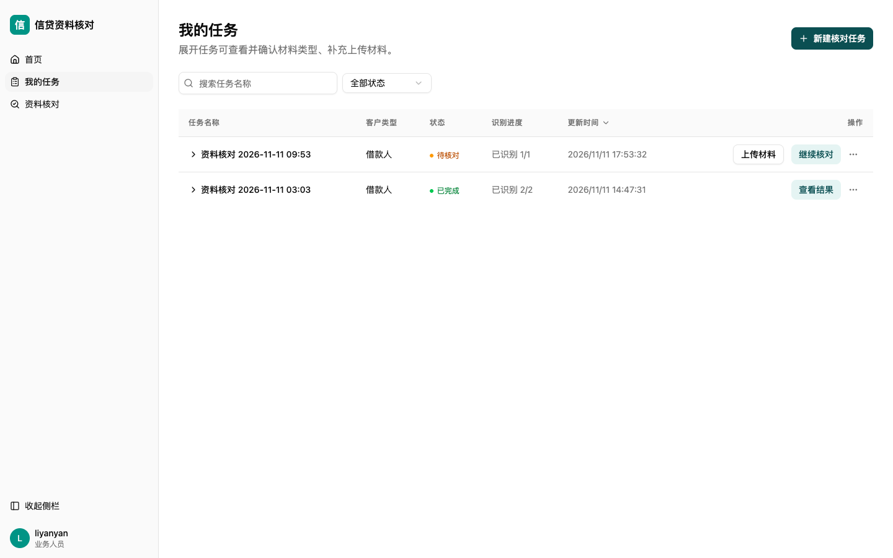

# 核对工作台评审交接

更新日期 2026-11-12（短样本串行基线 + QA 第 1 轮复验后修订；后端删除只读校验；补充用例 3：非空核对结果前后一致）  
分支 `feature/credit-review`。实际交付 commit：P0 `6a5b752`（feat）+ `e672eec`（docs）；P1 `2d41dd5`（feat）+ `74c163b`（docs）；性能方案 `783c371`（docs）；排序切换修复 `b90910b`；性能观测 Step1 `632f874`；任务操作列收尾与表格验收 `8c05fcc`（feat）+ `ccc2c91`（docs）；最后一轮定向收尾 `7f6b806`（feat）+ `29c18eb`（docs）；后端删除任务只读校验 `5167257`（fix + 测试证据）+ `e2cff93`（docs）；**补充用例 3 只更新证据与交接文档，为分支最新一条提交（无代码改动）**。历史独立复验依据三份交接及八张用户截图；表格验收 40 项见 `docs/screenshots/tasks_table_verify.json`、定向收尾 28 项见 `docs/screenshots/tasks_final_verify.json`；删除接口三个用例（含 `case3_results_consistency`）见 `docs/delete_readonly_verify.json`。

## 结论

第 4 轮主体功能可保留。**待办首尾环绕与表格完整交互已补验通过**（其中发现并修复了更新时间排序切换 bug）。**性能观测 Step 1（耗时记录）已完成**，章程提速仍需后续并发化。**任务操作列三槽位对齐已收尾并通过验收**（上一轮 40 项全通过）。**最后一轮定向收尾 3 个场景 28 项全通过**：补齐「从筛选结果直接上传」记录、封闭已完成行写操作并确认材料区只读、加深两处颜色后普通文字对比度全部 ≥ 4.5:1。**后端删除任务只读校验已补齐并实测通过**：`DELETE /tasks/{id}` 对已完成任务返回 409 `TASK_READ_ONLY` 且任务／材料／核对结果仍可读，待核对任务软删除仍可用。**补充用例 3**：带非空核对结果的已完成任务在 409 前后，`/results` 的 `run_id`、77 条结果条目、77 条人工决定与 statistics 完全一致（整份响应 SHA256 相同）。**短样本串行基线已本轮真实跑批完成**（`run_id=5547804d-da6d-4417-8139-9dc36e3b5e3e`，14 次真实模型请求、600.64s 后处理），证据 `docs/perf_baseline_2026-11-12.json`、脚本 `scripts/baseline_serial.py`；并发收益仍为推算、未经实测。详见「短样本串行基线（2026-11-12）」章节。QA 第 1 轮独立复验后已补充披露 run 绑定产物限制并修正 4 项标签/命令问题（未重跑基线、未改业务代码）。缺材料面板版式、长摘录键盘实测仍待收尾。

| 检查项 | 结论与证据 |
|---|---|
| 待办顺序与跨材料 | ✅ 已补验。17 次「下一条待处理」连续点击：营业期限 → 章程 6 项 → 财报 8 项（跳过已接受的「审计机构」）→「报告年度」→ 回到「营业期限」，**首尾环绕成立**；跨材料自动切换、保存后跳过均实测。单条/零条由 `jumpNext` 空队列提前返回 + `todo>0` 收起按钮保证。 |
| 统计、状态与计数 | 进行中截图的「未核对 14 + 待补原因 1 = 待处理 15」，「已核对 3/18」互补。拒绝待补原因未计入完成数。每条编辑态只有一个决定状态。缺材料及未找到证据的截图不再显示「1 条摘录」。 |
| 缺材料 | 单面板、补传、按需展开和缺失待办分组可见。折叠时面板仍被拉到接近整屏，展开后仍是多层整宽卡片，版式待收尾。逐项接受或拒绝、已完成回看按既有规则执行。 |
| 原文交互 | 用户标注确认点击长正文及箭头均可展开、收起，短摘录无箭头。键盘切换、复制时保持展开状态由实现说明支持，仍需实际操作记录。 |
| 我的任务 | ✅ 已补验并收尾。沿用 23 条固定测试数据（上一轮落为本地 fixture）验证：搜索（「测试」→ 7 条）、状态筛选（「已完成」→ 2 条）、搜索+状态组合（→ 1 条）、双向排序（desc↔asc，修复 `enableSortingRemoval:false`）、分页（23 条 → 20+3 两页）、筛选后单页收起分页、排序/翻页/筛选后任务 ID 命中均实测通过。**操作列三槽位对齐已修复**：真实服务上待核对与已完成两行的「继续核对／查看结果」x 坐标与宽度完全一致，已完成行上传槽位留空但占位。详见下节；上传覆盖范围已在最后一轮定向收尾中补齐（场景 1）。 |
| 原文定位与完成态 | 保留已交接的图片框选、PDF 跳页、已完成回查拒绝原因及写入拦截。PDF 区域框选、缩放后坐标一致性、PDF 连续翻页时右栏位置保持待复验。 |

## 性能观测（Step 1 已完成）

- `RunStep` 增加 `started_at/finished_at`（迁移 `b7e4c9d1a2f3`）；`ProcessingRun` 起止正确落库（修掉旧 `finished_at=None` 冗余）；管线在阶段级（`stage:classify/search/vision`）与检查项级（`check:{check_id}`）写 `RunStep`（`_touch_step` upsert）。
- 新增只读接口 `GET /tasks/{task_id}/runs/{run_id}/timing`，返回 run 起止耗时 + 各步骤耗时明细。
- **实测基线（营业执照单文件 run）**：总耗时约 70 秒；`stage:classify` 15s、`stage:search` 55s、`stage:vision` 0s；检查项中 `license.business_scope` 23s、`license.operating_term` 24s、`license.registration_status` 8s，章程/财报缺材料项均 0s 快速返回。已能定位最慢检查项。
- 章程旧跑批 54 分钟仍是历史参考（旧跑批缺阶段耗时），15 分钟记为并发化试验目标。
- 下方「短样本串行基线」章节的「下一轮待落实的设计」是本节 4 条历史方案的最新可执行细化；本轮已把「先能量出来」用真实跑批落地，并发化仍未实现。

## 短样本串行基线（2026-11-12）

**状态：已实测（本轮新增，未提交）。** 固定同一份 OCR JSON、清单、模型、提示词与窗口参数，真实调用 `qwen3.8-max-0902` 跑了一次完整串行链路。四态严格区分：**已实现**（串行链路、RunStep 起止、只读 timing 接口、窗口级容错分支）、**已实测**（本轮真实跑批的全部耗时/窗口数/调用次数/结果条目）、**待验证**（并发收益、限流与重试、只重试失败段、故障注入下的 `coverage_incomplete`）、**方案阶段**（下一轮 5 项设计，均未落地）。本轮未改业务代码、未改 `models.py`、未加迁移/接口、未重建 worker 镜像、未重新 OCR、未提交。

### 固定输入与指纹

| 固定项 | 值 | 说明 |
|---|---|---|
| OCR JSON | `/Users/eddie/Documents/WorkBuddy/合规审查智能体/《北京银行股份有限公司章程》 切分15页.PDF_by_PaddleOCR-VL-1.6_全参数开启.json` | SHA256 `8879c8a2d9ba8e702890f1fbf504f8f2ff4f0d08c8bc72366e10365ef0ebe60b`，143880 B，15 页 |
| 样本范围 | 原《北京银行股份有限公司章程》PDF 物理第 1–15 页，1:1 对应 | 原 PDF 共 62 页；物理页号 ≠ 页内印刷页码 |
| 清单 | `borrower-wcl-v1`，18 叶子（章程 6 项） | `checklist_hash() = 5f0c164276cf0fe8b68a758785cb984226dd4339e790e02e8b9773a036702337` |
| 模型 | `LLM_TEXT_MODEL = LLM_VISION_MODEL = qwen3.8-max-0902` | `APP_MODE=real` |
| 提示词 | `SEARCH_SYSTEM` sha256 `c93878b9…`、`CLASSIFY_SYSTEM` `20729704…`、`VISION_SYSTEM` `ceda71c3…` | 三个 JSON Schema 亦有 sha256，完整值见证据 `fingerprints.prompts` |
| 窗口 | 8000 字符 / 500 字符重叠 | `LLM_WINDOW_CHARACTERS=8000`、`LLM_WINDOW_OVERLAP_CHARACTERS=500`，运行时与常量一致 |
| 超时与重试 | 单次 180s、`LLM_MAX_TRANSIENT_RETRIES=2`、`LLM_MAX_CONCURRENCY=2`、`LLM_MAX_OUTPUT_TOKENS=4096`、`LLM_MAX_FORMAT_REPAIRS=1` | 并发上限本轮串行**未生效** |

导入落库后真实 OCR 文本为 **176 个块 / 9570 字符**（四次导入相同）。上述指纹后续并发对照**必须逐项一致，但只保证输入相同**：窗口边界、逐窗口字符数、窗口文本 hash、`messages_sha256` / `user_sha256` 与 `Result.fingerprint` 均绑定该次导入的 DB 行（含随机 `OcrBlock UUID`），仅凭 OCR JSON SHA256 复现不出，详见「样本局限」的 **run 绑定产物（QA 独立复验后补充披露）**。

### 执行与观测方式

在 `credit-review-app-worker-1` 容器内**同步直接调用 `run_pipeline.func(str(run_id))`**（Procrastinate Task 的原始函数），**不经过队列**：未 `defer`、未入队，队列轮询与调度开销**不计入**本基线；`Result` / `ResultSource` / `RunStep` / `ProcessingRun` 仍由业务代码正常真实落库。`docker exec` 传 stdin 必须带 `-i`。观测全部由脚本层 monkeypatch 完成（`LLMClient._chat`、`complete_json`、`chunk_source_blocks`、`chunk_blocks`、`search_check_item` 与四个阶段函数），不侵入业务代码；窗口数用真实 `chunk_blocks` / `chunk_source_blocks` 对真实 DB 块实测，跑批前 preflight 与跑批中观测**一致**。证据同时写容器内 `/tmp/baseline_evidence.json` 并输出到 stdout，两份 SHA256 均为 `64a9fe44842a11d4ff9c2d6d357187043b42ccc4cf6140d0bc9ed927c2a7ac47`（首次前台执行曾被宿主机侧 SIGTERM 打断导致 stdout 观测丢失，故加落盘兜底；那次 run `4333c31e-…` 完整 READY 但**不作基线数据**，详见证据 `session_notes`）。

### 基线表（全部实测）

| 指标 | 实测值 | 口径 |
|---|---|---|
| run_id | `5547804d-da6d-4417-8139-9dc36e3b5e3e` | DB `processing_runs` 真实存在，`READY / done / coverage_complete=true`，run 起止 600.636s |
| 隔离 task / file | `ddd97b17-8bfe-4954-b7fb-3f4f8386b879` / `9e4d3303-8501-46cc-bf47-a4357dcde09e` | 新建隔离数据，跑完 `deleted_at` 软删；未触碰 2 条真实业务任务 |
| **OCR 识别** | **未执行（复用既有 JSON，非本轮计时对象）** | 未调用外部 OCR 服务，不把复用 JSON 冒充 OCR 耗时 |
| OCR JSON 导入落库 | **0.107s** | `python -m app.cli import-ocr-json` 等价调用，单独计时 |
| 造隔离数据 / 建 run | 0.021s / 0.002s | 单独计时 |
| **后处理（OCR 之后）** | **600.64s** | `run_pipeline.func` 墙钟，含三阶段与 DB 写入 |
| 阶段 classify / search / vision | **44.612s / 555.990s / 0.006s** | `complete_run` 0.005s；DB `run_steps` 落库值 44.615 / 555.992 / 0.007s 与之吻合 |
| 总实测 | 600.78s | 造数据 + 导入 + 建 run + 后处理；不含证据读取与软删 |
| 窗口数（classify） | **2** | 7984 + 2158 字符（该次导入实测，见「样本局限」run 绑定产物披露） |
| 窗口数（6 个章程检查项） | **各 2**，共 12 次窗口调用 | 缺材料 12 项与 seal/signature 2 项实测窗口数 0、不调模型 |
| 模型调用 | **14 次 `_chat` / 14 次 `complete_json`** | 2 classify + 12 search；无 json_schema 降级、无 `_repair`、无视觉调用 |
| 单次请求耗时 | min 9.203 / max 140.537 / 均值 42.880 / 中位 35.951 / P95 68.777 / 求和 600.323s | 全部逐条记录，非仅平均值 |
| 超时 / 瞬时错误 / 窗口级重试 / 致命 / 格式错 / 格式修复 | **0 / 0 / 0 / 0 / 0 / 0** | 14 次全部 `ok=True`；attempt=0 由 `run_steps[].attempt`（19 条全 0）与三个空 detail 推得，非逐次调用直接观测 |
| 结果条目 | **44 行**（30 命中 + 14 not_found） | `no_matching_evidence` 2、`material_missing` 12、`coverage_incomplete` 0 |

**观测口径（QA 独立复验后补充披露）**：P95 采用脚本 `_dist` 的 `ordered[int(round((n-1)*0.95))]` 口径，n=14 → `ordered[12] = 68.777s`；常规线性插值 P95 = 93.893s、nearest-rank = 140.537s，均为不同口径的复算值（推算），外部复算须同口径。

**逐次真实 HTTP 请求（`_chat` 层，逐条记录）**

| # | 阶段 | 检查项 / 窗口 | 耗时(s) | response_format | 结果 |
|---|---|---|---|---|---|
| 1 | classify | 文件窗口 0 | 21.335 | json_schema | ok |
| 2 | classify | 文件窗口 1 | 23.263 | json_schema | ok |
| 3 | search | `charter.business_scope` 窗口 0 | 14.618 | json_schema | ok |
| 4 | search | `charter.business_scope` 窗口 1 | 34.033 | json_schema | ok |
| 5 | search | `charter.approval_body` 窗口 0 | 68.777 | json_schema | ok |
| 6 | search | `charter.approval_body` 窗口 1 | 55.654 | json_schema | ok |
| 7 | search | `charter.voting_ratio` 窗口 0 | 17.790 | json_schema | ok |
| 8 | search | `charter.voting_ratio` 窗口 1 | 26.838 | json_schema | ok |
| 9 | search | `charter.guarantee_restrictions` 窗口 0 | 52.334 | json_schema | ok |
| 10 | search | `charter.guarantee_restrictions` 窗口 1 | 37.869 | json_schema | ok |
| 11 | search | `charter.legal_representative_signature_authority` 窗口 0 | 49.038 | json_schema | ok |
| 12 | search | `charter.legal_representative_signature_authority` 窗口 1 | 9.203 | json_schema | ok |
| 13 | search | `charter.ownership_and_special_terms` 窗口 0 | **140.537** | json_schema | ok |
| 14 | search | `charter.ownership_and_special_terms` 窗口 1 | 49.034 | json_schema | ok |

每条结果的 `kind`、`text` 摘要（200 字）、`fingerprint`、`text_sha256`、`source_page_number` 与命中/未命中原因见证据 `results.by_check_item`；大段原文按指纹 + 短 hash 处理，未整份塞入证据。

### 关键条款命中对照

| 条款 | 物理页 | 目标检查项 | 结论 | 依据（实测） |
|---|---|---|---|---|
| 第十七条业务范围（含「外汇借款」「外汇担保」「提供信用证服务及担保」「贷款」） | 7 | `charter.business_scope` | **命中** | 1 条 text，出处页 7，text 含「第十七条」「外汇借款」 |
| 第二十四条 不以赠与/垫资/担保/补偿/贷款等形式资助购股人 | 8 | `charter.ownership_and_special_terms` | **未命中**（精确短语） | 样本 OCR 页 8 存在；该检查项页 8 有摘录，但 44 条结果无该精确短语，属摘录用词/截断差异，不是技术失败 |
| 第二十五条 增资须经股东大会分别决议 | 8 | `charter.approval_body` | **未命中** | 样本内存在，结果未含该短语 |
| 第四十一条 5% 以上股东质押书面报告 / 控股股东「借款担保」 | 13 | `charter.ownership_and_special_terms` | **未命中** | 样本内存在，结果未含该精确短语 |
| 第四十三条 对股东贷款条件不得优于其他借款人 | 13 | `charter.ownership_and_special_terms` | **命中** | 出处页 13 |
| 第四十四条 授信逾期限制表决权 | 13 | `charter.voting_ratio` | **未命中** | 样本内存在；该检查项整体 `no_matching_evidence`（覆盖完整后的真实「未找到」，非技术失败） |
| 股权出质事前告知 / 借款余额超股权净值不得质押 / 质押达 50% 限制表决权 | 14 | `charter.ownership_and_special_terms` | **部分命中** | 三短语中仅「50%」在结果中命中（页 14），另两个精确短语未出现，摘录不全 |
| 第四十六条 股东大会职权（十二）审议批准第四十七条担保事项、不得授权董事会 | 14–15（跨页） | `charter.approval_body` | **命中** | 3 条（页 14/15/15），页 15 含「审议批准第四十七条规定的担保事项」；`charter.guarantee_restrictions` 亦引用同短语，属证据重叠非误命中 |
| 第四十七条 五类须经股东大会审议的对外担保 | 15 | `charter.guarantee_restrictions` | **命中** | 7 条全部页 15，含「本行下列对外担保行为」「总资产30%」「资产负债率」「对股东」 |
| 法定代表人签字权限 | — | `charter.legal_representative_signature_authority` | **样本外条款，未命中** | 15 页 OCR 仅出现通用词「法定代表人」，无签字权限条款；返回 `no_matching_evidence`，未硬凑命中 |

**「外汇担保」误命中专项：未被误命中。** `charter.approval_body` 3 条（页 14/15/15）与 `charter.guarantee_restrictions` 7 条（全部页 15）均不含「外汇担保」「提供信用证服务及担保」「外汇借款」，且无第 7 页出处；经营范围里的「外汇担保」只出现在 `charter.business_scope` 第 7 页那 1 条里，属正确命中（证据 `clause_matrix.guarantee_vs_business_scope.any_foreign_exchange_guarantee_mis_hit = false`）。

**「未找到」与技术失败区分**：`no_matching_evidence` 2 条、`material_missing` 12 条、`coverage_incomplete` 0 条、`LLM_FATAL` 0 条；`fatal_error_count=0`、`format_error_count=0`、`window_level_retry_count=0`。本样本未触发技术失败分支，因此「严格区分」目前只验证了正常路径，**待故障注入/长样本验证**。系统只输出「证据 / 未找到」，不输出合规判断。

**C6 / C10 标签（QA 独立复验后修正）**：证据 `clause_matrix.matrix` 中 C6 改为「未命中：样本内存在但本次未被模型摘录召回（非技术失败）」、C10 改为「样本外条款：物理 1–15 页无「签字权限」条款，`no_matching_evidence` 符合预期（非技术失败）」；矩阵中不再出现「覆盖不全」字样，避免与 `coverage_incomplete`（本轮 0 条）混淆。C10 的 `present_in_sample_ocr=true` 仅由通用词「法定代表人」命中，已加 `present_in_sample_ocr_note`：本轮 psql 只读复验 176 块中该词 2 块（物理页 5 / 13），「签字」「签署」「签名」「签章」均 0 出现。

### 瓶颈判断（实测）与并发收益上限（推算，非实测）

**实测**：14 次请求耗时求和 600.323s ≈ 后处理 600.64s 的 **99.95%**，耗时几乎全部在模型 HTTP 等待；阶段占比 search **92.566%** / classify **7.427%** / vision **0.001%**。最慢检查项 `charter.ownership_and_special_terms` 189.584s（含单窗口 140.538s）、`charter.approval_body` 124.453s、`charter.guarantee_restrictions` 90.213s；缺材料 12 项与 seal/signature 项约 0.002s 且不产生模型调用。长尾来自单次请求的巨大方差（9.2s ~ 140.5s，P95 68.8s），不是 DB 写入或分窗开销。

**推算（基于串行实测，明确标注「推算，非实测」，待并发实测验证）**：假定并发度取 `LLM_MAX_CONCURRENCY=2`，忽略限流、排队、连接建立、DB 写入、调度开销及多 run 争用。

| 层次 | 串行实测基线 | 推算理想总耗时 | 口径 |
|---|---|---|---|
| 窗口级并发（检查项仍串行） | 555.732s | **371.561s** | 每个检查项耗时取该检查项两窗口最大值，再求和；最慢单检查项 140.538s |
| 检查项级并发（窗口仍串行） | 555.732s | **277.866s** | `max(总和/2, 最慢检查项 189.573s)` |
| 全局两层并发（C=2） | 600.332s（14 次 complete_json） | **300.166s** | `max(总和/2, 最慢单请求 140.538s)` |

以上三行**不是并发实测结果**。当前 `LLM_MAX_CONCURRENCY=2` 在串行链路中未生效（0 个同时在途请求）。

### 样本局限

**能验证**：串行链路完整（classify→search→vision→complete_run 全部真实执行且落库）；计时字段齐全（阶段墙钟、RunStep 起止、逐次请求耗时、OCR 导入与后处理严格分栏）；条款召回与出处页码可核对；超时/重试观测字段可采集（本轮实测为 0，说明链路未触发，不是没观测）；样本外条款走 `no_matching_evidence` 而非硬凑命中；经营范围「外汇担保」未被担保类检查项误引；窗口级容错分支代码可读。

**不能验证**：并发真实收益（本轮 0 个在途请求）；服务端 429 限流与排队；窗口级与检查项级两层上限的相互作用；多 run 并发的全局上限与会话隔离；62 页长章程下的断句、住所串入、去重与总耗时量级；失败窗口只重试的幂等与 `fingerprint` 合并去重。

**run 绑定产物（QA 独立复验后补充披露）**：QA 用 `--probe-only` 独立实跑 2 次，与早期 probe、本次基线共 4 次比对：`source_block_count=176 / source_total_characters=9570` 四次相同，但**窗口边界、逐窗口字符数、窗口文本 sha256 每次都不同**（win0/win1 字符数 7991/2086、7984/2158、7983/2137、7984/2092；hash `eb28ab09…`/`c5702341…`、`0ddb2baa…`/`7bc72b8a…`、`aec6322f…`/`6a6cc477…`、`00cedfdc…`/`5a10ed30…`）。根因是业务侧技术债（非本轮引入）：① `ocr_blocks.sequence_index` 只有 25 个不同值却存 176 块，`load_source_blocks` / `load_file_blocks` 只按 `sequence_index` 排序，同值行顺序由 DB 物理序决定 → 分窗边界漂移；② `_window_text()` 把每次导入新生成的随机 `block_id` 拼进窗口文本；③ `_fingerprint(check_item_id, block_id, start, end)` 同样含随机 `block_id`，基线 run 与中断 run 的同段文本 fingerprint 全部不同（QA SQL JOIN 8/8 为不同）。因此 **窗口文本 hash、逐窗口字符数、`messages_sha256` / `user_sha256`、`Result.fingerprint` 都是该次导入 DB 行的绑定值，仅本次 run 内自洽**；仅凭 OCR JSON SHA256 复现不出这些值。并发对照必须**复用同一批隔离数据（同一 file_id / 同一批 OcrBlock UUID）**；跨 run 逐条比对改用 `text_sha256 + source_page_number`，**不要用 `fingerprint`**。本轮不修改业务代码，仅如实披露。

**并发收益还需要**：更长样本（完整 62 页章程或窗口数 ≥ 6）产生可并行单位；同时派发多检查项 + 多窗口，制造 ≥ 2 个在途请求；可调并发度 1/2/4/8 与多 run 并发对照，观测 429 / P95 延迟变化；固定项（同一 OCR JSON SHA256 + 同一清单/提示词 hash）**只保证输入相同**，还须复用同一批隔离数据后跑多次取分布；注入超时/格式错/致命错验证有限重试、停止派发、只重试失败段；串行与并发结果按 `(check_item_id, text_sha256, source_page_number)` 逐条比对。

### 完整复现命令

```bash
cd /Users/eddie/Documents/WorkBuddy/合规审查智能体/credit-review-app

OCR_JSON="/Users/eddie/Documents/WorkBuddy/合规审查智能体/《北京银行股份有限公司章程》 切分15页.PDF_by_PaddleOCR-VL-1.6_全参数开启.json"
shasum -a 256 "$OCR_JSON"
# 期望 8879c8a2d9ba8e702890f1fbf504f8f2ff4f0d08c8bc72366e10365ef0ebe60b

docker cp "$OCR_JSON" credit-review-app-worker-1:/tmp/baseline_ocr_slice.json

# -i 必须；约 10 分钟，建议后台托管 docker exec，避免前台被 SIGTERM 打断 stdout
docker exec -i credit-review-app-worker-1 python - --evidence-out /tmp/baseline_evidence.json \
  < scripts/baseline_serial.py > /tmp/baseline_stdout.json

# stdout 管道若断开，用容器内落盘的同份证据兜底
docker cp credit-review-app-worker-1:/tmp/baseline_evidence.json /tmp/baseline_stdout.json

python3 -c "import json,pathlib; d=json.loads(pathlib.Path('/tmp/baseline_stdout.json').read_text()); pathlib.Path('/tmp/baseline_raw.json').write_text(json.dumps(d, ensure_ascii=False, indent=2)+'\n', encoding='utf-8')"
```

补充命令：`docker exec -i credit-review-app-worker-1 python - --probe-only < scripts/baseline_serial.py`（不调模型，只实测窗口数与指纹）；`docker exec credit-review-app-worker-1 python -m app.cli import-ocr-json --file-id <file_id> --json /tmp/baseline_ocr_slice.json`（仅导入，不触发外部 OCR）；只读 timing 接口 `GET /api/v1/tasks/{task_id}/runs/{run_id}/timing` 需先登录取 session cookie，且隔离任务已软删时需先把 `tasks.deleted_at` 置 NULL。证据 `fingerprints` 给出全部固定项 sha256，`reproduction` 给出同一套命令。**注意（QA 独立复验后补充披露）**：上面格式化命令只生成脚本原始输出到 `/tmp/baseline_raw.json`，**不可覆盖交付证据** `docs/perf_baseline_2026-11-12.json`；交付版另需按证据 `post_processing_notes.what_changed` 补回 5 个人工追加段（`session_notes` / `git_state` / `clause_verdicts_manual` / `post_processing_notes` / `database_verification`）、2 处标签修正与 QA 披露。证据 `reproduction.steps[6]` 的自检命令针对的是**交付版证据**。本次新跑批的自检请改读 `/tmp/baseline_raw.json`（由上面格式化命令产出），两者不可混用（QA 第 2 轮回归后订正）。固定项 sha256 逐项一致只保证输入相同；跨 run 复现窗口级指纹必须复用同一批隔离数据（同一 file_id / 同一批 OcrBlock UUID），跨 run 结果比对用 `text_sha256 + source_page_number`，不要用 `fingerprint`。

### 未提交状态与改动清单

**本轮未提交**（用户未要求），当前 HEAD `9c1eda1fc65fb132fd6e2a608876340fb8fa8e06`、分支 `feature/credit-review`。不写「本次文档提交号」（自引用必然失效）。新增/修改文件：

| 文件 | 变更 |
|---|---|
| `scripts/baseline_serial.py` | 新增：可复现串行基线脚本（固定项指纹 + monkeypatch 观测 + 容器内证据落盘） |
| `docs/perf_baseline_2026-11-12.json` | 新增：结构化证据（实测字段 + 单独分栏的推算 + 条款矩阵 + 会话/git 记录） |
| `docs/REVIEW_HANDOFF.md` | 原地更新：新增本章节 |

工作树另有 5 张 `docs/screenshots/review_*.png` 的 `D` 删除标记（他人造成）：**未 `git add -A`、未恢复、未提交、未纳入本轮改动**。隔离任务共 5 条（本轮 probe、首次中断跑批、本次跑批 3 条 + QA 第 1 轮独立复验 `--probe-only` 2 条 `20714d03-…` / `a4bc1759-…`）均已 `deleted_at` 软删，run / results / run_steps 保留可追溯。

### 下一轮待落实的设计

以下 **5 项均为方案阶段 / 待验证，本轮未实现**，给出可执行要点：

1. **并发上限（方案阶段）**。`LLM_MAX_CONCURRENCY=2` 当前串行未生效。两层上限不要相乘：设一个**进程/集群级全局信号量总闸**（等于 `LLM_MAX_CONCURRENCY`），检查项级与窗口级只从总闸里申领配额，窗口级并发度 ≤ 该检查项剩余配额；按服务端实测的 429 与 P95 延迟做 1→2→4 阶梯调节，每档记录吞吐、错误率、P95，达限流即回退一档；多 run 并发时必须把上限做成跨 run 的全局（DB 租约 / 分布式信号量），并在 `model_snapshot` 里记录本次生效并发度。本轮推算表不能当作上限设定依据。
2. **前端真实进度（方案阶段）**。当前仅「识别中 / 已识别」二态。前置条件：窗口级 `RunStep` 先落库（本轮只在脚本层观测，未落库）。以 `run_steps` 中窗口级 `SUCCEEDED` 数 / 总窗口数生成进度快照与进度条（本次实测总窗口 = classify 2 + 6×2 = 14；缺材料与 seal/signature 项不计入分母），阶段名与百分比都要有实际来源；轮询 2–5s 自适应、无变化时退避，run 进入 `READY/FAILED` 立即停止；失败窗口单独标红并显示 `last_error_code`，不并入「已完成」。
3. **单段失败如何标识（方案阶段，待故障注入验证）**。窗口级写 `RunStep(step_key=check:{check_id}:window:{i}, input_hash=窗口文本 sha256)`，记录 `state / attempt / last_error_code`；`coverage_incomplete`（存在未覆盖窗口）与 `no_matching_evidence`（所有窗口 SUCCEEDED 且无证据）严格分开，`LLM_FATAL` / `PARTIAL_COVERAGE` / 重试耗尽属技术失败，**不得标成「未找到」**；`run.coverage_complete` 只有在全部窗口 SUCCEEDED 时才置 true。本轮 0 次失败分支，须注入超时/格式错/致命错验证三种状态与文案。
4. **超时与有限重试（方案阶段，待注入验证）**。单次请求沿用 `LLM_REQUEST_TIMEOUT_SECONDS=180`，窗口级 `LLM_MAX_TRANSIENT_RETRIES=2` 加指数退避（如 1s/2s + 抖动），仅对 `LLMTransientError` 重试；`LLMFatalError` 立即停止该检查项后续派发并取消/丢弃在途请求结果；`LLMFormatError` 记未覆盖而非无限修复（现有最多 1 次 `_repair`）；增加 run 级 deadline 与「取消在途」的显式处理，避免致命错误后仍有请求写入结果。本轮 14 次请求 0 超时 0 重试，观测字段已具备，行为需注入验证。
5. **怎样只重试失败段（方案阶段）**。以 `(run_id, step_key, input_hash)` 为幂等键（现有唯一约束 `uq_run_steps_key_hash` 已支持），重跑时只挑 `state=FAILED` 或「无 SUCCEEDED RunStep 的窗口」，复用同一 OCR JSON（同一 SHA256）、同一清单 hash、同一提示词 sha256 与 8000/500 窗口参数，**且必须复用同一批隔离数据（同一 file_id / 同一批 OcrBlock UUID）**；结果按 `fingerprint`（`_fingerprint(check_item_id, block_id, start, end)`）合并去重——**该去重仅在「同一 run / 同一批 OcrBlock UUID 内」有效**（同 run 内去重成立，跨 run 因 `block_id` 随机而不可用），先按 `(run_id, check_item_id)` 清理旧行再插入或以 fingerprint upsert，避免整项重跑与重复写入；验收需比对重试前后结果集合与人工决定不漂移，并验证连续两次执行幂等。

**附：业务侧技术债（QA 独立复验后补充披露，方案阶段 / 待修）**：`ocr_blocks.sequence_index` 非唯一（176 块仅 25 个不同值）导致 `load_source_blocks` / `load_file_blocks` 排序不确定、分窗边界逐次漂移；`_window_text()` 与 `_fingerprint()` 把随机 `block_id` 写入窗口文本与结果指纹，导致 `window_text_sha256` / `messages_sha256` / `user_sha256` / `Result.fingerprint` 跨 run 不可比。下一轮需：给排序加稳定次级键（如 `provider_block_id` / 页序 / 主键）、把 `block_id` 从指纹与窗口文本中剥离或改用「页 + 块序号」稳定标识，并把 `input_hash` 幂等键建立在稳定标识上。本轮不修改业务代码。

## 本轮收尾

### 任务操作列（本轮已收尾）

**状态：已完成并通过验收。** 以当前代码和运行页面为准，上一轮已实现的排序、筛选、分页、只读限制等直接验收；仅修复操作列对齐与按钮样式差距。

**改动文件**（实际提交 `8c05fcc`）：

| 文件 | 变更 |
|---|---|
| `frontend/src/routes/_layout/tasks/index.tsx` | 操作列改为固定三槽位；「继续核对／查看结果」合并到同一槽位并统一浅青样式；「上传材料」改中性描边纯文字；「更多」补 `aria-label`；移除未用的 `Upload` 图标 import。 |
| `frontend/src/routeTree.gen.ts` | 构建时由 TanStack Router 插件自动重新生成，清掉上一轮已删除的 `$taskId.materials` 路由残留引用（HEAD 原文件指向不存在的文件）。 |
| `frontend/tests/fixtures/tasks-23.json` | 新增 23 条固定测试数据：以真实服务上 1 条待核对 + 1 条已完成任务为模板，补 21 条确定性记录。 |
| `frontend/tests/tasks-table.verify.mjs` | 新增独立验收脚本（Playwright + 系统 Chrome）：场景 A 走真实服务两行，场景 B 拦截 `/api/v1/` 用本地 fixture。 |
| `docs/screenshots/tasks_actions_two_states.png` | 待核对与已完成同屏截图。 |
| `docs/screenshots/tasks_table_verify.json` | 40 项验收结果与拦截请求明细。 |

**实现**：操作列从左到右固定「上传材料 / 进入或查看 / 更多」三槽位（前两槽各 88px、更多 32px），空槽位只占布局空间、不渲染内容，因此已完成行的「查看结果」与待核对行的「继续核对」横向对齐。待核对行未展开即可上传（上传成功后才展开材料列表）；已完成任务经「查看结果」进入同一 review 页，由 `editable = results.editable === true && task.state !== "COMPLETED"` 保证只读。复用现有 `Button`：页级「新建核对任务」保留加号与实心底色，行内「继续核对／查看结果」同为 `size="sm"` + ghost 基底叠加浅青底，「上传材料」用中性 `outline` 描边；三个行内文字动作均为纯文字，「更多」保留省略号图标并带 `aria-label="更多操作"`。**颜色与已完成行的写操作入口已在最后一轮定向收尾中调整**（见下节），布局与样式层级保持不变。

**验收**（`node frontend/tests/tasks-table.verify.mjs`，需前端已构建并同步到 api 容器）：**40 项 PASS / 0 FAIL / 0 PENDING**。

- 场景 A（真实服务、2 条真实任务）：三槽位存在性与空槽占位、两行入口 x 坐标与宽度一致（`x=1276.0/1276.0, w=80.0/80.0`）、两个入口计算样式一致（浅青底 + 青绿字、32×80）、上传为中性描边、行内纯文字与更多省略号、页级新建加号与实心青绿、更多可访问名称、未展开即可触发文件选择器、进入只读页（`editable(api)=false`，无「完成核对」及接受／拒绝按钮）、继续核对命中对应任务 ID（此处颜色为上一轮当时色值，最后一轮加深后见下节）。
- 场景 B（23 条 fixture，拦截 `/api/v1/`）：默认 20 行 / 2 页、默认降序、desc↔asc 双向且无第三态、搜索「测试」7 条、状态「已完成」2 条、组合 1 条、结果缩到一页时分页收起、清空筛选恢复 2 页、翻到第 2 页 3 行；在「排序后(asc)」「筛选后(已完成)」「翻页后(第 2 页)」三种状态下核对展开（GET files）与进入（Link href）命中的任务 ID 与所在行一致。**上传 POST 实际只有两笔**，分别来自「排序后(asc) 同视图待核对行 `…0005`」与「翻页后(第 2 页) 首行 `…0003`」，两笔均命中对应行 ID；「筛选后(已完成)」组**仅验证上传槽位留空**（该视图无待核对行），当时未覆盖「从筛选结果直接上传」。该覆盖缺口由最后一轮定向收尾的场景 1 补齐。



**通过项**：要求 1（三槽位、对齐、空槽占位、未展开可上传、已完成只读入口）、要求 2（按钮组件复用与色彩／尺寸／纯文字／可访问名称）、要求 3（两状态同屏、21+ 条双向排序／搜索／状态组合筛选／翻页／单页收起分页／操作 ID 命中）全部实测通过；TypeScript 类型检查与 Vite 构建通过；前端产物已同步到运行中的 api 容器（8080）并验证新资源可达。

**待验项 / 范围外**：

- 真实文件上传后的 OCR／LLM 闭环不在本轮范围（会触发外部服务）。上传只验证到文件选择器与拦截到的 POST 请求任务 ID；**本轮未发生外部服务阻塞，无卡点需记录**。只读页使用已有识别结果（`已核对 77/77`），未重新跑批。
- 缺材料面板版式、长摘录键盘实测、PDF 区域框选等沿用上一轮待验项。
- 既有工程提示（非本轮引入，未改）：`biome.json` schema 2.6.3 与本机 CLI 2.6.7 不匹配；`tasks/index.tsx` 的 import 顺序不符合 `organizeImports`（HEAD 原版同样报错）。

**本轮复现**：先构建并同步前端 —— `cd frontend && VITE_API_URL= npx vite build --outDir /tmp/credit-review-fe --emptyOutDir`，再 `docker cp /tmp/credit-review-fe/. credit-review-app-api-1:/app/backend/app/frontend/`（`VITE_API_URL` 置空保证同域 API，构建产物不入库）；然后 `node frontend/tests/tasks-table.verify.mjs`（默认 `http://localhost:8080`，可用 `VERIFY_BASE_URL` 覆盖；浏览器用系统 Chrome，可用 `VERIFY_BROWSER_CHANNEL` 覆盖）。

### 最后一轮定向收尾（3 个场景，28 项全通过）

**状态：已完成并通过验收。** 独立复验确认操作列对齐通过后，只补跑三个相关场景：沿用上一轮 40 项结果与 23 条 fixture，不重跑全流程。本轮脚本 `frontend/tests/tasks-final.verify.mjs`，结果 `docs/screenshots/tasks_final_verify.json`（**28 项 PASS / 0 FAIL / 0 PENDING**），截图位置 `docs/screenshots/tasks_actions_two_states.png`（已覆盖更新，即上节所附图片）。

**改动文件**（实际提交 `7f6b806`）：

| 文件 | 变更 |
|---|---|
| `frontend/src/routes/_layout/tasks/index.tsx` | 已完成行「更多」菜单改为唯一禁用只读项；展开材料区按任务状态禁用分类下拉与删除文件按钮并标注只读、空态文案改只读；行内入口字色与页级新建底色加深为 `#0B4F52`；状态文字 600→700 档。 |
| `frontend/tests/tasks-final.verify.mjs` | 新增只跑三个定向场景的补充验收脚本。 |
| `docs/screenshots/tasks_final_verify.json` | 28 项结果 + 上传 ID 证据 + 菜单/材料区快照 + 逐项对比度明细。 |
| `docs/screenshots/tasks_actions_two_states.png` | 覆盖更新两状态同屏截图。 |

**场景 1 — 筛选结果直接上传（补齐记录）**：用现有 23 条 fixture，状态筛选「待核对」→ 6 条，取首行「资料核对 2026-11-11 09:53」，在**未展开**状态下直接经「上传材料」选入测试文件并拦截 POST。行任务 ID（取自该行「继续核对」href）= `607e6d41-4d47-4582-a5ad-07313b6c17bd`；请求路径 = `/api/v1/tasks/607e6d41-4d47-4582-a5ad-07313b6c17bd/files`；路径任务 ID = 同一值，**两者一致**；上传后筛选状态与 6 条结果保持不变。上一轮该覆盖缺口的表述已在上文同步修正。

**场景 2 — 已完成行「更多」菜单与材料区只读**：

- 修正前实测：菜单实际项 `['删除任务']`（写操作）；展开材料区有 2 份文件、2 个分类下拉 + 2 个删除文件按钮，均可点击，但后端 `files.py`（上传／删文件／分类）、`tasks.py`（PATCH）、`runs.py`（决策）对 `COMPLETED` 均返回 `409 TASK_READ_ONLY`。
- 按既有只读规则修正：已完成行菜单改为唯一禁用项 `['已完成任务不可修改']`，**槽位、省略号图标与 `aria-label` 均保留**（即「菜单无可用项，保留槽位」）；待核对行菜单仍为 `['删除任务']`，未误伤。材料区标注「· 只读」，2 个分类下拉与 2 个删除文件按钮全部 `disabled`，空态文案改为「暂无文件（任务已完成，只读）」，上传槽位仍留空。
- **后端纵深防御（当时缺口，现已补齐）**：`DELETE /tasks/{id}` 软删除当时对 `COMPLETED` 未做 409 拦截（其余写接口均已拦截），前端入口虽已封闭但直接调 API 仍可软删已完成任务。**该缺口已在本轮后端 BugFix 中补齐并实测通过，详见下节。**

**场景 3 — 颜色加深与对比度（浏览器计算色）**：

- 加深：行内「继续核对／查看结果」字色 `text-primary` → `#0B4F52`；页级「新建核对任务」底色 `bg-primary` → `#0B4F52`（hover `#093E40`）。与原 `--primary` 同色系、仅降明度；布局与「页级实心 > 行内浅青 > 上传中性描边」层级不变。为让同页普通文字整体达标，状态文字由 600 档升到 700 档（「颜色圆点 + 文字」表达方式不变）。
- 方法：浏览器 `getComputedStyle` 取计算色，用 canvas 把 `oklch / oklab`（含 alpha）光栅化为 sRGB，再按 WCAG 相对亮度公式计算，不靠肉眼估算。
- 实测（改前 → 改后）：页级新建 3.61 → **8.92:1**；继续核对 3.33 → **8.23:1**；查看结果 3.33 → **8.23:1**；上传材料 19.8:1。其余普通文字全部 ≥ 4.5:1：表头 4.54、任务名称 19.8、客户类型 19.8、识别进度 4.74、更新时间 4.74、状态·待核对 3.20 → **5.03**、状态·已完成 3.22 → **4.95**。逐项明细见 `tasks_final_verify.json` 的 `evidence.contrast_metrics`。

**通过项 / 待验项**：三个场景 28 项全通过；TypeScript 类型检查与 Vite 构建通过；新前端已同步到运行中的 api 容器（8080，`index-mbYLtTGm.js`）。当轮新增的「后端软删除 409 缺口」已由下一节所述后端 BugFix 补齐；本轮未触发 OCR／LLM，无外部服务阻塞。复现：`cd frontend && node tests/tasks-final.verify.mjs`（构建同步命令见上节）。

### 后端删除任务只读校验（BugFix，实测通过）

**状态：已完成并通过验收。** 前端已验收，测试范围限于 `DELETE /tasks/{id}` 删除接口。用隔离测试数据对**运行中的实际后端**（api 容器 8080，已重建镜像加载新代码）先跑两个用例（**40/40 断言 PASS**、14 次请求、脚本 EXIT=0，路由判定 NoOne），本轮再补一条「非空核对结果前后一致」回归（**27/27 断言 PASS**、7 次请求）；合计 **67/67 PASS、21 次请求**。结构化证据 `docs/delete_readonly_verify.json`（token／密码脱敏；补充回归在 `case3_results_consistency` 块，合计口径见 `combined_summary`，原 40 项记录保持不变）。

**改动文件**（实际提交 `5167257`）：

| 文件 | 变更 |
|---|---|
| `backend/app/api/routes/tasks.py` | `delete_task` 在写 `deleted_at` 前新增 `if task.state == "COMPLETED": raise HTTPException(409, {"code": "TASK_READ_ONLY", "message": "任务已完成，不可删除"})`；非完成态路径逐行不变。 |
| `docs/delete_readonly_verify.json` | 原两用例 40 项断言／14 次请求；本轮追加 `case3_results_consistency`（27 项断言、7 次请求、77 条结果条目与人工决定逐条指纹、前后响应 SHA256）与 `combined_summary`。 |

复用同文件 `update_task`（约 112 行）、`files.py` 149／205／224、`runs.py` 76／381 的既有 `TASK_READ_ONLY` 规则；权限仍由 `OwnedTask`（owner + `deleted_at IS NULL`）保证，`require_csrf` 在函数体之前执行；409 分支在写入前返回，零写入。容器内 `/app/backend/app/api/routes/tasks.py` 131 行已核验为新校验。

**用例 1 — 已完成任务（当前用户有权操作）：PASS**

| 项 | 结果 |
|---|---|
| 隔离数据 | `42b0b193-d367-4b23-b4e6-5e348e46531c`「QA 删除只读-已完成」，owner `fdb34c0f-…4999`，持久化与对外 state 均 `COMPLETED`，删除前 `deleted_at=NULL`；挂 1 条材料 `QA-C1-材料.pdf`（1024B）与 1 条 SUCCEEDED OCR job |
| `DELETE /api/v1/tasks/{id}` | **HTTP 409**，响应体 `{"detail": {"code": "TASK_READ_ONLY", "message": "任务已完成，不可删除"}}` |
| 数据可读 | `GET /tasks/{id}` **200**（`state=COMPLETED, file_count=1`）；`GET /tasks/{id}/files` **200**（1 条，含 `original_name/media_type/size_bytes/ocr_status`）；`GET /tasks/{id}/results` **200**（`editable=false, items=[]`，隔离数据未跑核对流程故为空，接口本身可读）；`GET /tasks` **200** 且仍包含该任务 |
| 零写入 | DELETE 后及三个 GET 之后两次查库，`deleted_at` 均为 `NULL`、`state` 仍 `COMPLETED` |

**用例 2 — 待核对任务（当前用户有权操作）：PASS**

| 项 | 结果 |
|---|---|
| 隔离数据 | `7d68995f-b94a-4914-ba2d-da68b0e6bdf8`「QA 删除只读-待核对」，持久化与**对外推导** state 均 `REVIEWING`（挂 1 条 SUCCEEDED OCR job 使 `_effective_state` 推导为 REVIEWING），删除前 `deleted_at=NULL` |
| `DELETE /api/v1/tasks/{id}` | **HTTP 204**，空响应体（现有软删除行为不变） |
| 软删除生效 | 查库 `deleted_at = 2026-11-12 03:12:18.965212+00`、`state` 仍 `REVIEWING`；`GET /tasks/{id}` **404** `{"detail": {"code": "RESOURCE_NOT_FOUND", "message": "任务不存在"}}`；`GET /tasks` **200** 且不再包含该任务 |

**测试与数据边界**：登录 `liyanyan` 取 session cookie + `X-CSRF-Token`，4 个写请求均带 `Origin: http://localhost:8080`，14 次请求无 403 CSRF_FAILED，409／204 均为真实业务响应。**未触发 OCR／LLM**（未调用 files／runs／complete 接口，SQL 造的两条 `ocr_jobs` 为 SUCCEEDED 终态；测试窗口实测新增 active OCR job = 0、processing run = 0）。隔离数据用 `POST /api/v1/tasks` 创建后改库造状态；测试后两条均软删（用例 1 因 COMPLETED 走 SQL 标 `deleted_at`），最终 `GET /tasks` 只剩 2 条真实任务，其 state 与 `deleted_at=NULL` 未变化；未触碰前人「测试任务 T01…」数据。语法检查 `python3 -m compileall` 通过；api 镜像经 `docker compose build api` + `up -d api` 重建重启，8080 健康 200，worker/db 未动、无需迁移。

**补充用例 3 — 带非空核对结果的已完成任务：DELETE 前后 `/results` 完全一致（本轮新增，PASS）**

只补这一条接口回归；前端与待核对任务软删除用例沿用既有结果，未重跑。用现成测试数据克隆，避免触发 OCR／LLM：以真实已完成任务 `ee59108d-e4f1-4aa8-bf2e-afe07d457384` 的最新 READY run `fad721d5-a179-40c3-9203-04822ce84350`（77 条 results、77 条 decisions）为源，SQL 克隆到新建隔离任务 `ee347bb8-ec27-49b6-ba05-7f517f48a129`「QA 删除只读-带非空结果」（`state=COMPLETED`，克隆 run `f65001b7-01c0-4902-836e-4409af5e148e`）。全程只调用 login、`POST /tasks`、GET、DELETE，未调用 files／runs／complete；测试窗口新增 OCR job = 0。

| 步骤 | 结果 |
|---|---|
| 删除前 `GET /results` | **200**，`run_id=f65001b7-01c0-4902-836e-4409af5e148e`、**77 条 items**、`editable=false`、`is_stale=false`；人工决定 **76 accepted / 1 rejected**，拒绝原因「材料识别有误，需人工复核」（`version=3`、`updated_at=2026-11-11T08:43:51.861034Z`）；`statistics.overall = {total:77, accepted:76, rejected:1}` |
| `DELETE /api/v1/tasks/{id}` | **HTTP 409**，`{"detail": {"code": "TASK_READ_ONLY", "message": "任务已完成，不可删除"}}` |
| 删除后重读 `GET /results` | **200**，`run_id` 不变、仍 77 条 items、`editable=false`、statistics 不变 |
| 一致性核对 | `run_id` 相等；**77 条结果条目 id 序列相等**；逐条关键字段（含 `decision`／`reject_reason`／`version`／`updated_at`）相等；statistics 相等；**整份响应 SHA256 前后均为 `d78af252c57715d76f3a55fcf421782b13b2867533a8925d15bc2492155d0d03`**（字节级一致） |
| 零写入 | DELETE 后查库 `deleted_at` 仍为 `NULL` |

证据存放：`docs/delete_readonly_verify.json` 的 `case3_results_consistency`（`before/after` 摘要 + 77 条 `item_fingerprints` + 27 项 `checks` + 7 次 `requests`），合计口径见 `combined_summary`（40+27 = **67 项全通过**、14+7 = 21 次请求）；原 40 项断言与 14 次请求记录保持不变。完整 `/results` 响应各含 77 条 items、原文较长，故以逐条指纹 + 整份响应 SHA256 作为可核验证据。测试后隔离任务用 SQL 标软删（COMPLETED 不能走 DELETE），克隆子行保留以便追溯；最终 `GET /tasks` 只剩 2 条真实任务，其 state 与 `deleted_at=NULL` 未变。

**通过项 / 待验项**：三个用例全部 PASS（合计 67 项断言），「后端软删除 409 缺口」已闭环，且非空核对结果在 409 前后字节级一致。仍待验：缺材料面板版式、长摘录键盘实测、PDF 区域框选等此前条目；`worker` 容器仍为旧镜像（本改动只在 api 路由，不在 worker 执行路径，无影响）。

### 缺材料和待办

- 收起时外框高度随摘要内容，边框在状态、数量和操作区之后结束。展开后用轻量列表显示受影响项，保留逐项接受／拒绝和历史决定。顶部统一解释「接受仅确认本次缺失记录」，每行保留检查项名称和必要操作。缺失材料仍可进入待办，跳转时展开并聚焦具体条目。
- 补一组短的首尾环绕测试，记录最后一条 → 第一条的真实条目 ID，另测单条、零条和保存后跳过。用一条待补原因验证跳转后可直接填写原因，保存后计数才更新，原文高亮对应当前定位条目。
- 长摘录补验 Enter / Space、拖选复制和点击「定位原文」。保留已通过的正文及箭头展开体验。

## 性能下一步

本节为历史方案清单；第 1 条「先能量出来」已由 2026-11-12 短样本串行基线落地实测（见上文章节），第 2–4 条仍未落地。

现有交接记录章程旧跑批 54 分钟，搜索路径约 6 个检查项 × 6 个窗口，约 36 次串行调用。这个数字可作历史参考，旧跑批缺阶段耗时。15 分钟记为试验目标。

1. **先能量出来。** 记录 run 与阶段起止、窗口排队与实际请求耗时、请求次数、超时和重试。阶段进度用已完成检查项或窗口数，阶段与百分比有实际来源。
2. **用同一输入做并发对照。** 固定 OCR JSON、清单、文本模型、提示词和窗口切法，测串行与有上限的并发。优先用单层任务队列调度检查项与窗口。核对上限覆盖实际进程部署和多 run 并发场景，按服务实际返回的限流及延迟逐步调节。独立数据库会话、稳定去重和排序、重复执行幂等都要用结果验证。模型请求设置明确的超时和重试边界，致命错误后停止派发并处理仍在途的请求。
3. **另测减少调用。** 试一个窗口同时查多个检查项，记录调用次数、耗时和关键条款召回。固定模型响应时，串行与并发结果按条目内容、来源和去重结果比对。真模型、批量提示或换模型时，用人工核对过的关键证据、来源正确性及差异清单验收。换模型、并发和批量策略分别记录收益。
4. **补一次实际长章程验收。** 回传基线、改动后耗时和关键条款差异。记录超时或限流下是重试、失败还是覆盖不全，覆盖不全与正常未找到明确区分。同时用新跑批核实断句、住所串入和去重。区域框选与财报印章／签名继续按各自用例验证。

## 单一交接文件约定

后续在项目中只维护 `docs/REVIEW_HANDOFF.md`。先将 P0、P1、性能方案中的仍有效信息并入此文件并提交，再清理同目录下已合并的副本。历史可通过 Git 提交回查，测试证据可链接到对应截图、日志或测试输出。每轮原地更新实际 commit、本轮变更、通过项、待验项和下一步。功能已实现、已实测、待验证与方案阶段使用明确的状态。

## 依据

- 上一轮实测证据（`8c05fcc`）：验收脚本 `frontend/tests/tasks-table.verify.mjs`、本地 fixture `frontend/tests/fixtures/tasks-23.json`、结果日志 `docs/screenshots/tasks_table_verify.json`、同屏截图 `docs/screenshots/tasks_actions_two_states.png`。
- 最后一轮定向收尾证据（`7f6b806`）：`frontend/tests/tasks-final.verify.mjs`、`docs/screenshots/tasks_final_verify.json`（含上传 ID 证据、菜单/材料区快照、逐项对比度）、覆盖更新后的 `docs/screenshots/tasks_actions_two_states.png`。
- 后端删除只读 BugFix 证据（`5167257` / `e2cff93`）：`docs/delete_readonly_verify.json`（原两用例 40 项断言／14 次请求 + 补充用例 3 的 27 项断言／7 次请求、77 条结果条目与人工决定逐条指纹、前后响应 SHA256；合计 67 项全通过）。
- 短样本串行基线（本轮，未提交）：脚本 `scripts/baseline_serial.py`、结构化证据 `docs/perf_baseline_2026-11-12.json`（run `5547804d-da6d-4417-8139-9dc36e3b5e3e`，14 次真实模型请求、后处理 600.64s、classify/检查项各 2 窗口、44 条结果）；完整复现命令、瓶颈判断与下一轮 5 项设计见「短样本串行基线（2026-11-12）」章节。
- 项目经验参考（工作区根目录，非交接文档）：`沉淀经验.md`、`交接文档.md`。
- [P0 开发交接](https://chatgpt.com/library?file_id=libfile_ee54a80106b88191b01199fc450549c3&account_id=personal)
- [P1 开发交接](https://chatgpt.com/library?file_id=libfile_5242edc5a9688191875bb85b1dd64c09&account_id=personal)
- [性能方案](https://chatgpt.com/library?file_id=libfile_2010869f426c8191b7f29f2a7681cc0a&account_id=personal)
- [任务操作列](https://chatgpt.com/library?file_id=libfile_10b91779b0cc8191bdfb278454430761&account_id=personal)
- [正文与待办导航](https://chatgpt.com/library?file_id=libfile_d22819b414648191844da3d6934f782d&account_id=personal)
- [缺失面板折叠态](https://chatgpt.com/library?file_id=libfile_a0fbaaa07ee081918dfd4c11d81b3ad0&account_id=personal)
- [Python 并发任务与取消语义](https://docs.python.org/3/library/concurrent.futures.html)
- [SQLAlchemy 会话并发模型](https://docs.sqlalchemy.org/en/20/orm/session_basics.html#is-the-session-thread-safe-is-asyncsession-safe-to-share-in-concurrent-tasks)
