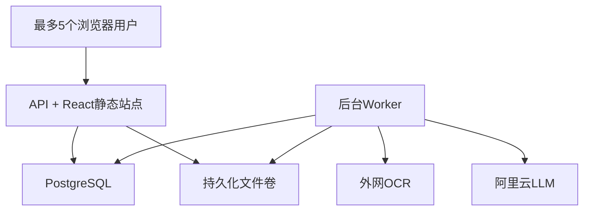
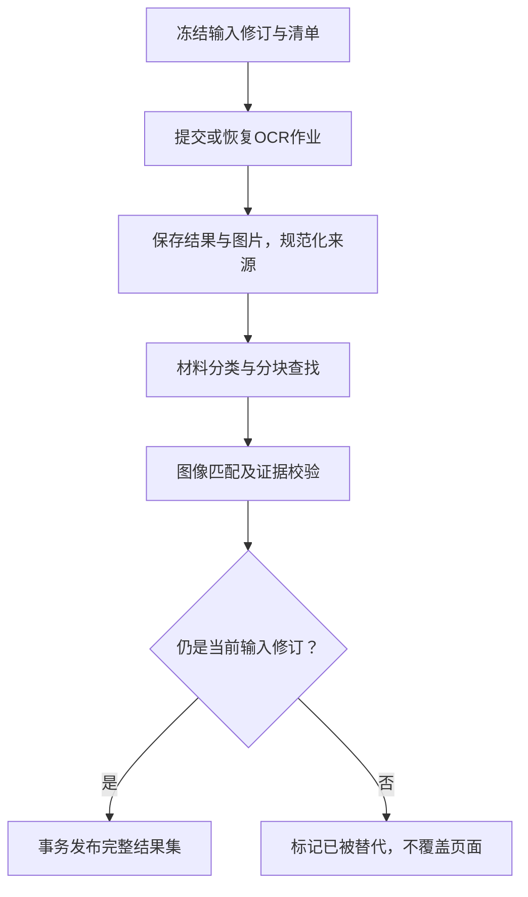

# 架构与实现决策

版本V0.1；需求V0.5。以下为本地实现基线，不代表已完成部署。

## 1. 选型结论与取舍

采用模块化单体：FastAPI API与worker复用同一Python工程；React SPA；一套PostgreSQL与本地持久化文件目录。面向最多5名同时使用者，支持排队，不引入集群。

选择Python是因为本期工作重心在OCR/文档/模型适配与证据处理，已有调用案例可以直接沿用；没有必须复用的Java工程。Java/Spring适合已有Java平台时的统一治理，TypeScript全栈也可行，但本期增加语言或AI编排层并不能减少核心业务开发。

使用FastAPI官方全栈模板指定提交，保留React/TypeScript、shadcn/ui、TanStack Query/Router、表单、SQLModel/Alembic、密码哈希及测试基础。用户名登录需替换模板邮箱语义；注册、密码恢复、SMTP、用户后台、默认示例Item、Adminer、Traefik、Sentry接入均从本期默认部署移除。保留许可证。模板的前端已由FastAPI同域服务，可以直接复用，不另加Nginx。

数据库选PostgreSQL：用户/任务/文件/证据/确认之间关系明确，需要事务与约束；少量可变元数据用JSONB。原始OCR JSON、原文件和图片保存在文件存储，不把全部大Base64塞进业务行。后续存储替换为对象存储时，替换Storage接口，不改变证据ID。

Procrastinate 3.10.0为队列基线，复用PostgreSQL，实现持久化排队和重试。不是自写数据库轮询队列。需要配置停滞任务恢复；库不会替业务自动实现外部请求幂等或断点续跑。安装与Python3.14兼容需P0实测并记录锁文件。

## 2. 逻辑模块

| 模块 | 职责 | 不承担 |
| --- | --- | --- |
| Auth/Ownership | 用户名登录、会话、资源归属 | 注册与用户管理页面 |
| Task/Material | 任务、不可变文件、分类纠正、输入修订 | 贷款审批决策 |
| Pipeline | 阶段编排、批次、重试、覆盖校验、发布结果 | 自主生成不受控工具调用计划 |
| OCRAdapter | 提交、查询、下载、规范化来源 | 本地部署OCR推理模型 |
| LLMAdapter | 文字/视觉调用、超时、Schema校验、用量 | 本期多厂商代理平台 |
| Evidence/Decision | 证据归属、逐条确认、原因、完成事务 | 修改OCR原文或人工补写证据 |
| Storage | 安全流式保存、鉴权读取、原件和图片关联 | 默认公网暴露文件目录 |
| Web | 当前任务、双栏查看器、交互、保存反馈 | 作为统计与权限真值来源 |

## 3. 物理部署

正常常驻容器只有db、api、worker；另有一次性migrate/init操作。API和worker用同一个构建镜像、相同代码版本、相同挂载路径。API一个服务进程即可；worker只启动一个实例，默认同时运行3个轻量异步步骤，全机共享OCR活跃作业信号量1、LLM信号量2。不要靠每个HTTP请求临时创建信号量。扩多个worker前必须把配额控制迁移成数据库协调，不能直接扩副本。

外部OCR已提交并等待时，不占数据库连接。浏览器每2秒查询任务状态，有结果后停止轮询；隐藏标签页可降至10秒。先使用普通HTTP轮询，不建设WebSocket。用户切换任务不取消后台处理。

## 4. 文件处理与结果发布

文件变更时先增加task.input_revision，标记旧批次SUPERSEDED，再建立新批次。未变文件的OCR可在同一用户/任务范围内复用；受影响材料及依赖项重新查找。旧结果可标注过期供查看，但处理期间不可继续确认或完成。新结果集完整校验后一次发布，避免混入两个批次的统计。

归档的OCR不因LLM超时而重跑。重试模型步骤读取已归档块；已知external_job_id时恢复查询，不重复提交OCR。网络在提交返回前中断而无法确定是否已创建外部作业时，标记SUBMISSION_UNKNOWN，向用户说明，不自动循环重交导致重复计费。

## 5. 数据一致性与重启

- 新批次与队列任务必须同一PostgreSQL事务提交，使用Procrastinate外部连接能力；P0验证与SQLModel所用psycopg连接的桥接和回滚。禁止先提交业务行、仅用FastAPI BackgroundTasks入队后就宣称可靠。
- 每步按run_id/stage/file_id建唯一执行记录；业务写入幂等，重试可能至少执行一次，不能假定恰好一次。
- 已提交OCR编号、阶段、截止时间、重试次数、工件存储键写DB。客户端关闭不影响后台作业。
- worker优雅停止；异常中断使用库的heartbeat/stalled-job机制进行受控恢复。恢复前检查输入修订、已有阶段结果及外部jobId。
- 完成核对锁task行；拒绝原因、结果版本及当前批次检查与完成标志在同一事务。并发文件更新和完成最多只能一个成功。
- 人工确认使用decision.version进行乐观锁；同账号两个标签不能静默覆盖。五个不同账号之间不共享任务。

## 6. 身份与文件安全

复用模板的Argon2密码哈希与JWT实现，不编写密码学。JWT移入HttpOnly会话Cookie，增加auth_sessions表存sid、用户、到期与撤销状态；每个受保护请求同时验证签名、exp、sid、用户启用状态。退出撤销该sid，清Cookie和当前用户缓存。默认8小时，无自动刷新；到期重新登录，已保存任务继续保留。

同域默认Cookie：HttpOnly、SameSite=Lax、Path=/；HTTPS时Secure=true。写请求除登录外携带与会话绑定的CSRF token，校验Origin；不允许带凭据的通配CORS。登录也验证Origin和JSON内容类型。CSRF token通过已登录会话接口获取，不放URL。CSRF不替代归属检查。

所有task/file/result/asset先通过当前用户约束查询；跨账号不存在统一返回404。worker从可信run/task记录加载owner，不能信任模型/队列参数中的任意fileId。文件存储在非静态目录，GET资产必须走鉴权路由；PDF支持Range。原始文件名只作为显示名，不拼接磁盘路径。远程图片仅抓取配置允许的HTTPS主机，限制重定向、大小、时间与图片像素，禁止抓取本机/内网地址。

## 7. 模型调用与可观测

先使用OpenAI Python SDK调用此前阿里云兼容Chat Completions；分别配置文字与视觉模型，不强制使用实时音视频模型。SDK处理HTTP，业务层定义结构化输入、输出、重试和引用校验。模型不输出审批结论。模型不支持严格json_schema时可用json_object加本地严格校验；最多一次格式修复，仍失败为技术失败。

统一记录request_id、owner_user_id、task_id、run_id、file_id、stage、耗时、错误类别、模型名、用量（若接口返回）。默认不记录全文、图片Base64、密钥或带签名URL；原始外部响应保存在受保护工件。健康探针不发真实模型请求，不产生费用。

## 8. 扩展边界

客户类型/产品通过带版本的JSON清单扩展；OCR和LLM各有适配器，存储有统一接口。暂不做微服务、Redis、反向代理集群、embedding、向量库或多Agent。以后增加需要时先记录具体触发条件与迁移方案，不在这版预建平台。
