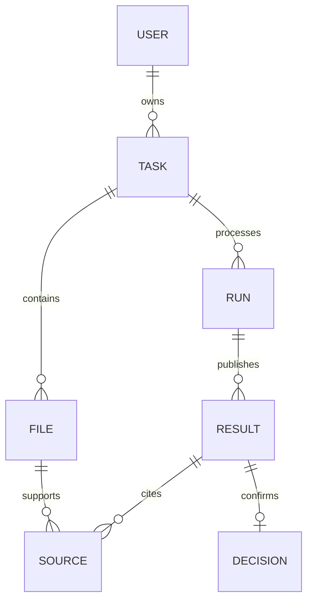

# 数据模型、版本与事务

数据库PostgreSQL；SQLModel/SQLAlchemy模型与Alembic迁移由实现Agent编写。本节为规范，不能只用前端localStorage实现持久化。ID使用UUID，时间使用timestamptz/UTC，文件大小使用bigint；枚举使用字符串加约束或迁移管理，不依赖展示中文作为主键。

## 1. 实体与字段

| 表 | 必要字段及规则 |
| --- | --- |
| users | id；username（2–64字符，去首尾空格、ASCII用户名大小写不敏感，唯一）；password_hash；is_active；created_at。密码8–128字符，CLI初始化，不能存明文 |
| auth_sessions | id/sid；user_id FK；expires_at；revoked_at nullable；csrf_token（随机值，已认证的/auth/me可返回，不记日志）；created_at。JWT含sub、sid、iat、exp；不保存明文密码或完整JWT |
| tasks | id；owner_user_id FK；name（1–120）；product_code；customer_role；checklist_version；state；input_revision默认0；current_run_id nullable；last_ready_run_id nullable；created_at/updated_at/completed_at |
| task_files | id；task_id FK；original_name；media_type；size_bytes；sha256；original_asset_id；source_page_count；manual_material_type nullable；created_at；deleted_at nullable。文件字节不可变，更换生成新fileId |
| assets | id；task_id；file_id nullable；kind（original/ocr_raw/page_raster/crop）；storage_key；sha256；media_type；size_bytes；width_px/height_px nullable；created_at。路径不返前端 |
| ocr_jobs | id；task_id/file_id；request_config_hash；provider_job_id nullable；state；attempt；submitted_at/next_poll_at/deadline_at；result_asset_id nullable；last_error_code；provider_metadata JSONB（不含token） |
| ocr_pages | id；task_id/file_id/ocr_job_id；provider_line_index；provider_item_index；ocr_page_index（0起）；source_page_number（1起或null）；mapping_status；raster_asset_id nullable；width_px/height_px nullable；coordinate_space；rotation/transform_metadata JSONB |
| ocr_blocks | id；task_id/file_id/page_id；provider_block_id/group_id/global_* nullable；sequence_index；label；canonical_text；table_html nullable；bbox/polygon JSONB nullable；raw_content_ref；crop_id nullable。id为系统全局ID |
| crops | id；task_id/file_id/page_id/block_id；provider_label；kind（seal/signature/image/unknown）；recognized_text nullable；image_asset_id nullable；bbox/polygon；image_status。未下载成功不能假装有图片 |
| processing_runs | id；task_id；input_revision；checklist_snapshot JSONB及hash；model/prompt/config版本；state；stage；input_manifest_hash；coverage_complete；error_code；created_at/started_at/finished_at |
| run_files | run_id/file_id复合主键；task_id；effective_material_type nullable；classification_source；classification_reason；ocr_job_id nullable。冻结本批次文件集合及人工分类，不实时读可变输入 |
| run_steps | id；run_id/file_id nullable；step_key；input_hash；state；attempt；provider_request_id nullable；result_asset_id nullable；last_error_code。唯一(run_id, step_key, input_hash) |
| check_executions | id；task_id/run_id；check_item_id；dependency_hash；search_status（found/not_found）；coverage JSONB；completed_at。每叶子项必须正常结束并至少有一条结果，才能发布 |
| results | id；task_id/run_id/check_execution_id；check_item_id；kind（text/table/seal/signature/not_found）；text nullable；table_html nullable；crop_id nullable；recognition_source（ocr/vision/null）；relation_status（matched/needs_review/null）；not_found_reason nullable；rank；fingerprint |
| result_sources | id；task_id/result_id；file_id/page_id/block_id；start_char/end_char nullable；source_page_number nullable；bbox/polygon nullable；location_precision（region/page/none）。每条证据允许多处来源 |
| decisions | result_id主键；task_id；decision（unselected/accepted/rejected）；reject_reason nullable；version默认0；actor_user_id；updated_at；carried_from_result_id nullable。不存在视同unselected |
| decision_events | id；task_id/result_id；actor_user_id；event_type；before/after JSONB；created_at。用于查明重置、原因变更和继承，不建设日志页面 |
| view_states | user_id/task_id/material_type复合主键；file_id nullable；page_number；zoom；left_anchor JSONB；right_anchor JSONB；updated_at。只保存阅读状态，不作为确认或权限依据 |
| idempotency_keys | user_id/task_id/key/operation唯一；request_hash；response_status；response_body JSONB；expires_at。默认24小时，用于开始与重试/完成等重复提交 |

队列自身表和迁移由Procrastinate管理；不将其内部表结构复制为自建队列，也不把队列doing/succeeded直接当任务状态。

## 2. 关系

run_files支持同一不可变文件被不同批次引用；ocr_pages与blocks可由后续批次复用。results始终属于一个批次，不能修改run_id以伪装新结果。旧记录保留，读取当前统计时只选择tasks.current_run_id的结果。

## 3. 状态枚举

| 对象 | 状态及含义 |
| --- | --- |
| Task | DRAFT未开始或全部文件已移除；PROCESSING排队/处理；REVIEWING结果已发布可核对；FAILED本轮技术失败；COMPLETED已结束只读 |
| Run | QUEUED、RUNNING、READY、FAILED、SUPERSEDED。SUPERSEDED不可再发布，不是用户确认失败 |
| OCRJob | NOT_SUBMITTED、SUBMITTED、RUNNING、DOWNLOADING、SUCCEEDED、FAILED、SUBMISSION_UNKNOWN。外部pending映射SUBMITTED；done后还须成功归档 |
| Step | QUEUED、RUNNING、SUCCEEDED、FAILED、SUPERSEDED |
| Decision | unselected、accepted、rejected。rejected可临时空原因保存，但不可完成 |

任务PROCESSING时保留last_ready_run_id供只读看旧结果，界面明确“材料已变更，结果更新中”。统计不把旧结果当新结果进度。FAILED不发布部分结果为完整可确认结果。配置缺失作为阻止开始的错误原因，不创建空的READY批次。

## 4. 完整性与索引

- 所有task关联资源均有task_id。为被引用表建立UNIQUE(task_id,id)，子表用复合FK(task_id,parent_id)阻止跨任务串联；同时保留常规主键。应用仍必须通过owner_user_id查询。
- results的run_id必须属于同task；sources的file/page/block必须相互对应并在run_files快照内。这些不能由LLM自行定义。
- 索引：tasks(owner_user_id,updated_at DESC,id)；task_files(task_id,deleted_at)；runs(task_id,input_revision DESC)；results(task_id,run_id,check_item_id,rank,id)；sessions(user_id,expires_at)；steps(run_id,state)；ocr_jobs(state,next_poll_at)。
- check_executions唯一(run_id,check_item_id)；source集合和crop引用去重。组内多候选允许多results；一个未找到项只生成一条not_found。
- decisions：非rejected时reject_reason必须null；rejected允许null/空字符串表示草稿；完成时用strip后非空校验。原因上限4000字符，不静默截断。
- checklists存于版本化配置文件；run保存完整快照，不能修改旧版本内容后继续标为同一版本。
- 文件hash仅用于同一任务的幂等/复用；不做跨用户去重引用，避免存在性泄露和归属混乱。相同字节重复上传可提示并返回原fileId，不重复加数量。

## 5. 输入修订与受影响范围

上传/删除/更换文件及人工分类变化：锁task，拒绝COMPLETED，校验If-Match输入修订。提交后input_revision+1。DRAFT只更新草稿；已开始任务自动排新批次。最后一份文件移除后回DRAFT、当前结果不再可确认，不执行空输入查找。

默认依赖按材料类别和清单dependencies计算。某类文件集合、分类、相关OCR配置变化，重跑该材料全部检查项；跨项目标变化（例如审计机构名称供印章匹配）同时重跑依赖项。不能只保留旧文字相同的印章确认，因为候选池可能已变化。

新批次对未受影响材料可复用旧证据并创建新的resultId。只有check版本、dependency_hash、规范化结果payload和来源集合完全一致，才复制其确认及原因；记录carried_from_result_id。受影响项即使原文巧合相同也重置。新结果总数可以变化；统计重新计算。

## 6. 关键事务

### 开始/重试

验证owner、配置、有效文件、borrower及清单版本；锁task；检查Idempotency-Key。创建冻结快照和run，并同事务入队。完成事务后返回202。重复key且请求一致返回原run；请求不同返回409。已存在同revision的活跃run时返回该run，不再排一次。

### 确认/重置

锁task再读result/decision，确认任务REVIEWING、run是当前READY批次。校验decision If-Match版本，写选择/原因/event，version+1。重置写unselected、原因null。响应包含新的decision版本及同事务计算的statistics；客户端不可推测计数。

### 完成

锁task；校验run_id/input_revision、READY、coverage_complete、无技术失败、N>0、所有叶子有结果、U=0、空白拒绝原因数M=0。满足后state=COMPLETED、completed_at=now，同事务提交。即使R>0或确认了未找到也可完成。重复完成返回同一完成状态。

## 7. 统计定义

N为当前发布批次results数，U/A/R按decision分组，N=U+A+R；M为rejected且原因strip为空。accept_rate=A/N、reject_rate=R/N，接口返回0–1数值或N=0时null，前端格式化百分比。确认进度=A+R，但M>0仍不可完成。材料进度同口径，优先级待补原因>全部核对>核对中>未开始，拒绝不使材料变为红色警戒。
